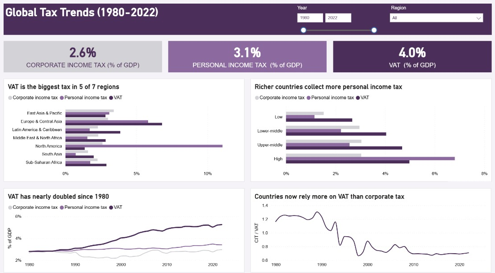
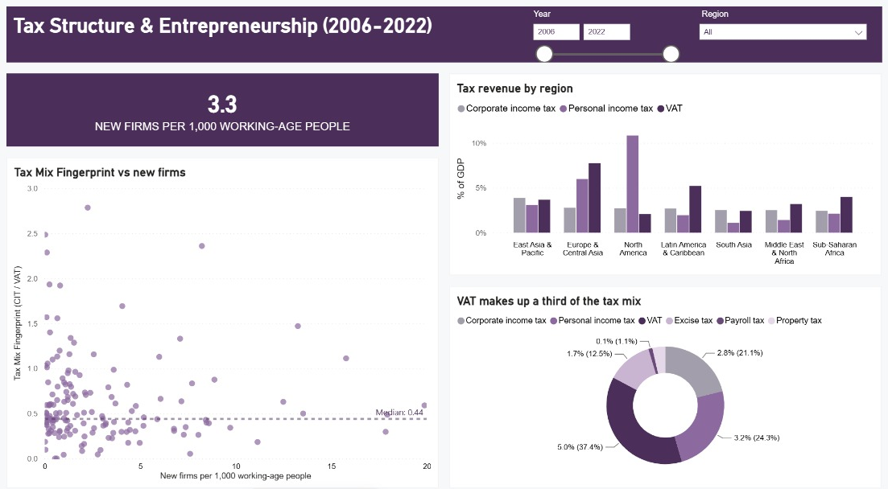

# Global Tax Reform & Entrepreneurship Analysis

How do a country's tax choices affect how many new businesses start there? This project uses machine learning on 43 years of World Bank data (1980–2022, 196 countries) to find out, and turns the results into an interactive policy simulator and a Power BI dashboard.

Completed as part of a Master of Business Analytics Capstone at Sunway University (May 2026).

## Key Results
- **XGBoost Regressor:** R² of 0.67 on unseen future years (2018–2022), a 177% improvement over the OLS baseline (R² 0.24)
- **Random Forest Classifier:** 74.8% accuracy predicting a country's income group from its tax data
- **Key finding:** Countries with a CIT-to-VAT ratio below ~0.23 show higher predicted business formation (SHAP threshold, stable across 20 model retrains)
- **Top driver:** Personal income tax had the largest SHAP impact on business entry
- The model captured the drops in new business formation during the 2008 Financial Crisis and COVID-19

Models were trained on 2017 and earlier and tested on 2018–2022, so each country's future is predicted from past data only.

## Live Dashboard
[Tax Response Engine](https://tax-response-engine.onrender.com): interactive policy simulator built with Gradio and Plotly. Adjust a country's tax mix and see the predicted effect on new business formation, with SHAP explanations. (It may take a minute to wake up.)

## Power BI Dashboard
A supplementary two-page Power BI report summarising the data behind the models.

**Page 1 – Global Tax Overview (1980–2022):** how corporate income tax, personal income tax and VAT compare across regions and income groups, and how the tax mix has shifted towards VAT over four decades.

**Page 2 – Tax Structure & Entrepreneurship (2006–2022):** new business density, the Tax Mix Fingerprint (CIT ÷ VAT) against new firms, and the breakdown of the tax mix.

Open `global_tax_trends_dashboard.pbix` in [Power BI Desktop](https://www.microsoft.com/en-us/power-platform/products/power-bi/desktop) (free) to use the year and region filters.

## Approach
1. **Data cleaning:** merged World Bank tax revenue indicators with new business registration data, fixed recording errors, and filled missing values using country, region and income-group medians (the target variable was never imputed)
2. **Feature engineering:** created the *Tax Mix Fingerprint* (CIT ÷ VAT), the direct-to-indirect tax ratio, and a 2-year lag of corporate tax
3. **Modelling, in two tracks:**
   - *Regression:* predict new business density (new firms per 1,000 working-age people), comparing OLS, Fixed Effects, Random Forest and XGBoost
   - *Classification:* predict income group (Low → High), comparing Random Forest and XGBoost
4. **Validation:** time-based train/test split, hyperparameter tuning with time-series cross-validation, overfitting checks, and comparison with alternative models (SVR, KNN, Naive Bayes, logistic regression)
5. **Explainability:** SHAP analysis to identify which taxes drive predictions, and the CIT-to-VAT threshold

## Data
- **Source:** World Bank (tax revenue indicators and new business registrations)
- **Coverage:** 8,408 country-year rows, 196 countries, 1980–2022
- New business data is available for 170 countries from 2006 to 2022, so the regression track uses that period; the classification track uses the full panel

## Tech Stack
Python, Pandas, Scikit-learn, XGBoost, SHAP, Statsmodels, Matplotlib, Seaborn, Plotly, Gradio, Power BI

## Files
| File | Description |
|---|---|
| `data_cleaning.ipynb` | Data wrangling and missing value imputation |
| `eda_and_modelling.ipynb` | EDA, feature engineering, modelling, SHAP and the Gradio dashboard |
| `clean_dataset.xlsx` | Cleaned dataset |
| `featured_dataset.xlsx` | Dataset with engineered features, used for modelling |
| `global_tax_trends_dashboard.pbix` | Power BI dashboard |
| `dashboard_page1.png`, `dashboard_page2.png` | Dashboard screenshots |

## How to Run
The notebooks were built in Google Colab. To run `eda_and_modelling.ipynb`, open it in Colab, upload `featured_dataset.xlsx` (and `clean_dataset.xlsx` for the feature engineering step), and run the cells in order.
